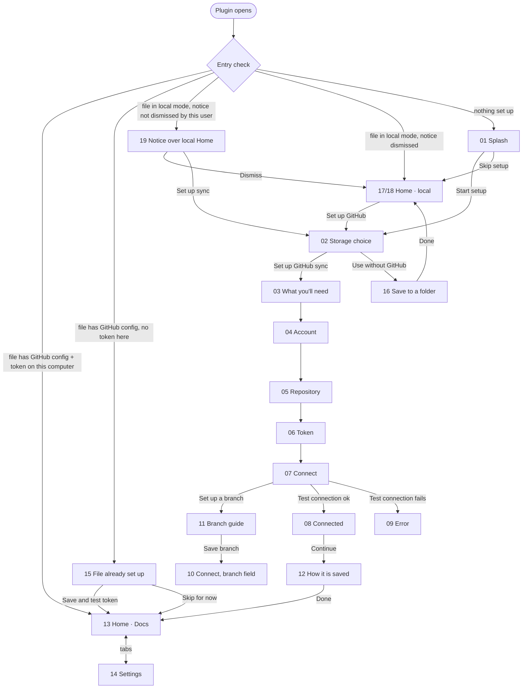

# Figma Docs Sync: design handoff (onboarding, home, settings, local mode)

Design state: 27 Nov 2026, style guide v0.8. Designer: Jakob. This folder is the complete design input for implementing the plugin UI.

## 0. How to read this folder

| Path | What it is | Use it for |
|---|---|---|
| `HANDOFF.md` | This spec: flow, states, behaviour, data, open questions | Logic and decisions |
| `screens/NN-name.html` | One static HTML file per screen, 468 × 760. Open in a browser; buttons link to the next screen | Exact layout, spacing, copy, icons (inline SVG) |
| `screens/png/` | Screenshot of each screen | Quick visual check, visual diff target |
| `prototype/index.html` | All screens wired together, with disabled buttons, the branch swap and local mode. Open in a browser | How the flow feels end to end |
| `tokens/tokens.css`, `tokens/tokens.json` | Colours, type, spacing, radius, sizes | Build the UI on these tokens, never on raw hex |
| `reference/` | Banner spec, status colours, all failure/success banners (3 boards), draft of the external guide website | Error states and banner copy |

**Priority if things conflict:** this file > `screens/*.html` > `prototype/` > `reference/`. The HTML uses inline styles because it came out of a design canvas. Treat it as a pixel spec, not as code to paste in. Rebuild it with the project's component structure and the tokens.

**Copy is final.** Take every visible string from the screen HTML, word for word. Don't rephrase.

---

## 1. Global rules

- **Window:** `figma.showUI(__html__, { width: 468, height: 760 })` for every screen. (`tokens.json` still says 360 as the panel width. 468 wins.)
- **Screen anatomy:** fixed header (setup progress bar or the Docs/Settings tabs), a scrollable middle, and a fixed footer with the actions (top border `--border`, padding 16/20). Only the middle scrolls. Long content scrolls *under* the footer, and the actions stay visible. Splash and storage choice have no footer.
- **Theme:** dark only. No gradients, no shadows.
- **One primary (amber) button per view.** Amber is only for the primary action, progress, done checks, the focus ring and the required `*`.
- **Accessibility target:** WCAG AAA where possible, AA minimum. Colour never carries meaning alone: status = icon shape + text + colour.
- **Focus:** `outline: 2px solid var(--accent); outline-offset: 3px` on every interactive element.

## 2. Components

| Component | Spec |
|---|---|
| **Primary button** | 44px high, `--accent` fill, `--on-accent` text, 13px/600 sans, radius 4. In the footer it takes `flex: 1.4` next to Back (`flex: 1`). |
| **Primary button, disabled** | Fill `--surface-2`, text `--muted` (6.4:1), 1px border `--border`, `cursor: not-allowed`, `aria-disabled="true"`, removed from the tab order. **Rule:** a screen with a required field keeps its primary button disabled until the field has a non-empty (trimmed) value. Optional fields never disable anything. Back and secondary buttons are never disabled. |
| **Secondary button** | 44px, transparent, 1px border `--muted`, text `--text`. |
| **Inline button** | 36px, same look as secondary, icon + label (Test connection, Choose folder, Mark as doc, Replace token). |
| **Text field** | Label 12px/500 sans `--text`. Input 36px, `--surface-2`, 1px border `--muted`, radius 4, values in mono 12px. Helper text 12px `--muted` below. |
| **Required mark** | Amber `*` right after the label text, `aria-hidden="true"`. The input itself gets `required` / `aria-required="true"`. |
| **Optional mark** | `(optional)` after the label, mono 12px 400 `--muted`, margin-left 6px. A field is never marked both ways. |
| **Banner** | A small window. A header strip in the status colour holds the navy icon and title (13px/600). Below it a `--surface` body with 12px text, then an optional link. 1px border in the status colour, radius 6, overflow hidden. Strip padding 6px 8px, body padding 8px. Title ≤ 5 words, always present. `role="status"` (success/info) or `role="alert"` (warning/error). An error always names a next step. |
| **Link** | `--secondary`, 13px/500, underlined. A small ↗ arrow icon **only** when the link leaves the plugin (GitHub, website). In-plugin links have no arrow. |
| **Notice dialog** | Banner used as a modal (see screen 19). Scrim `--scrim` over the whole window, banner centred with 20px side margin, body padding 16px, text 13px. Two 44px buttons: secondary left (Dismiss), primary right. `role="dialog"`, `aria-modal="true"`, `aria-labelledby` = the title. Focus goes to the primary button on open and is trapped. Esc = Dismiss. |
| **Guide screen layout** | Used by steps 1–3 and the branch guide: progress header → `###` title → one intro paragraph → schematic GitHub window (dots + URL bar, mono labels, highlight rings and numbered badges in `--secondary`, never amber) → numbered steps `01 02 03` (mono, amber numbers) → "Full guide with screenshots ↗" link → footer with the field + Back / primary. |
| **Progress header** | Label "SETUP PROGRESS" + "n / 4" (mono 11px uppercase), 4px bar (`--surface-2` track, `--accent` fill), `role="progressbar"` with `aria-valuenow`/`aria-valuemax`. |
| **Tabs (Home)** | Segmented control: track `--surface`, active tab `--surface-2` + `--text` + `aria-current="page"`, inactive `--muted`. Two tabs only: Docs, Settings. |
| **Status word** | Mono 11px uppercase with an icon: DONE (amber disc with check), MISSING (dashed ring). |

## 3. Screen inventory

| # | File | Screen | Notes |
|---|---|---|---|
| 01 | `01-splash.html` | Splash | Logo is a placeholder. "Start setup" → 02. "Skip setup" → 17 (local Home, no folder). |
| 02 | `02-storage-choice.html` | Where should docs go? | Info banner "GitHub only, for now" is always shown. "Set up GitHub sync" → 03. "Use without GitHub" → 16. |
| 03 | `03-what-you-need.html` | What you'll need | Overview, no progress bar. → 04 |
| 04 | `04-step1-account.html` | Step 1/4 · GitHub account | "Open github.com/signup" opens the external URL. "I have an account" → 05 |
| 05 | `05-step2-repository.html` | Step 2/4 · Repository | **Repository link\*** required. Primary "I added the repository" disabled until filled. |
| 06 | `06-step3-token.html` | Step 3/4 · Access token | **Fine-grained token\*** required (`type=password`). Primary "I added my token" disabled until filled. |
| 07 | `07-step4-connect-untested.html` | Step 4/4 · Test your connection | Prefilled from 05/06. Folder (optional, default `docs`). "Set up a branch (optional)" row → 11. |
| 08 | `08-step4-connect-connected.html` | Step 4 · connected | After a successful test: success banner "Connected", text "Can read and write `owner/repo`. Token expires in N days." |
| 09 | `09-step4-connect-error.html` | Step 4 · test failed | Error banner "Can't connect to repository" + external link. More error variants are in `reference/fail-1…`. |
| 10 | `10-step4-connect-branch-set.html` | Step 4 · branch set | Once a branch is saved in 11, the "Set up a branch" row is **replaced** by a **Branch (optional)** text field with the name, helper "The branch your docs are saved on." and an in-plugin link "More about branches" → 11. Applies to the untested and connected states alike. |
| 11 | `11-branch-guide.html` | Create a branch (optional) | Guide layout, progress stays 4/4. Field "Branch name", prefilled `design-docs`. **Empty = the repo's default branch.** "Save branch" → back to 07/08/10 (keep the test state). "Back" → back without saving. |
| 12 | `12-how-its-saved.html` | How it is saved | Two cards: "In this file · Shared" (repo, branch, folder) and "On this computer · Only you" (token, masked to the last 4). Info banner "Nothing is final" + "Open Settings" → 14. "Done" → 13. |
| 13 | `13-home-docs.html` | Home · Docs | Box "This file saves to" (repo/branch/folder) → link to Settings. Mark as doc, docs list with status, footer Download .zip / Sync. Shows example banners (frame missing, edited in GitHub). |
| 14 | `14-settings.html` | Home · Settings | Sections "This file · shared" (Change for everyone) and "On this computer · only you" (token status, expiry, Replace token, "Your overrides": branch/folder, Override for me). This is the only place where the word "override" appears. |
| 15 | `15-file-already-set-up.html` | This file is set up | Entry state: file configured, but no token on this computer. Token field required → "Save and test token" disabled until filled. "Skip for now" → 13 (sync unavailable). |
| 16 | `16-local-save-to-folder.html` | Save to a folder (optional) | Local mode. Folder path (optional) + "Choose folder". Done: with a path → 18, empty → 17. **See open question Q1 (feasibility).** |
| 17 | `17-home-local.html` | Home · local mode | Info banner "Local mode": not synced, download as .md. Footer Refresh / Download .zip. "Set up GitHub" link → 02. |
| 18 | `18-home-local-folder.html` | Home · local, folder saved | Like 17, banner text says where files are saved (shows the path). |
| 19 | `19-notice-sync-not-set-up.html` | Notice for teammates | Dialog over 18/17: "Sync is not set up" / "Syncing is not set up in this file. Everything is saved locally on your computer." Dismiss → Home (local). "Set up sync" → 02 (full onboarding). |

## 4. Flow

Back buttons always go to the previous step and keep entered values.

## 5. Data model

There are **no projects.** Configuration lives in two places:

| Data | Scope | Suggested storage |
|---|---|---|
| Mode (`github` \| `local`), repository (owner/name), branch (empty = default), docs folder (default `docs`) | **Per Figma file, shared** with everyone who opens it | `figma.root.setPluginData(...)` |
| Stable file ID for per-file user keys | Per file | Generate once and store in pluginData. `figma.fileKey` isn't available to public plugins. |
| Access token | **Per user, this computer only. Never in the file** | `figma.clientStorage` |
| Personal overrides (branch, folder) | Per user, per file | `figma.clientStorage`, keyed by file ID |
| Local folder path | Per user, this computer | `figma.clientStorage`, keyed by file ID (a path only makes sense on the machine where it was chosen) |
| Notice dismissed (screen 19) | Per user, per file | `figma.clientStorage` key such as `notice-dismissed:<fileId>` |

Effective value = personal override if set, else the file value.

## 6. Behaviour details

- **Disabled primary (05, 06, 15):** re-evaluate on every `input` event. Trimmed empty → disabled. No validation message on empty; format validation happens on Test connection.
- **Connect (07–10):** Repository link and token are prefilled from steps 2–3 and editable. "Test connection" calls GitHub with the token and checks read/write on Contents for the repo. A changed field after a successful test resets to the untested state (07). The success banner shows the repo and the token expiry.
- **Testing state** isn't designed. Use the inline button with `aria-busy="true"`, the label "Testing…" and the refresh icon spinning (respect `prefers-reduced-motion`), and block double clicks.
- **Error mapping:** use the banners in `reference/fail-1-connection-token.html` (token rejected, expired, expiring soon, repo not found, read-only, org approval needed, offline, GitHub error, rate limit) and `fail-2-repo-branch-sync.html` (branch missing/protected, archived repo, edited in GitHub, frame deleted, changed in both places, partial failure, duplicated file). Field-level errors are shown under the field in the error style shown there.
- **Branch:** empty means the repo's default branch. A non-existent branch name is created on the first sync. Once saved, show it as a field on Connect (screen 10). "More about branches" reopens the guide prefilled with the current value.
- **How it is saved (12):** values reflect the actual config. The token is masked to `••••••••` + the last 4 characters.
- **Local mode (16–19):** setting up locally writes `mode = local` into the file. The **next person** who opens a file in local mode sees dialog 19 once. Dismissing stores the per-user flag. "Set up sync" starts at 02, and finishing GitHub setup switches the file to `mode = github` for everyone.
- **External links** ("Full guide with screenshots", "Open github.com/signup", error help links) open in the browser via `window.open` from the UI (or `figma.openExternal`, depending on the existing code). The guide website isn't built yet. Keep the URLs in one config constant.

## 7. Accessibility checklist

- Every input has a `<label for>`. Required fields have `aria-required`, and the `*` is `aria-hidden`.
- Disabled buttons have `aria-disabled="true"` and are skipped by Tab. Never use opacity alone.
- Banners: `role="status"` / `role="alert"`, the icon `aria-hidden`, and the title text carries the meaning.
- The schematic GitHub windows are `role="img"` with an `aria-label` (see HTML). Their inner text isn't announced.
- The dialog traps focus, Esc closes it, and focus returns to the trigger or the first tab.
- After a screen change, move focus to the screen's `h1`.
- Minimum target 32px (tabs), 36px (inline), 44px (footer).

## 8. Open questions: ask Jakob, don't guess

- **Q1, local folder feasibility.** A Figma plugin's UI iframe probably can't write into a chosen folder on disk (sandboxed, no File System Access API). Check this first. If it isn't possible, propose the fallback to Jakob before building screen 16: hide the path field and keep "Download .zip", or another approach. Don't silently drop the screen.
- **Q2, Continue on Connect.** It is currently enabled before and after a failed test (see 09). Recommendation: disable it until the test succeeds. Confirm with Jakob.
- **Q3, "How it is saved" (12).** Required step or skippable? The recommendation was skippable (it's reachable from Settings too).
- **Q4, notice frequency (19).** Once per person per file (current assumption) or every time?
- Logo on the splash is a placeholder.

## 9. Out of scope / don't implement

Old canvas boards that are **not** in this folder: the project concept (S-02 Projects tab, S-06 Add project, A-07 project, A-08 done), variants B-02…B-04 and C-01…C-05, `Main`, and the older A-03…A-06 copies. Projects no longer exist.

## 10. Done when

- [ ] All 19 screens match `screens/png/` at 468 × 760 (layout, copy, tokens).
- [ ] The flow in section 4 works end to end, including both entry checks and local mode.
- [ ] Disabled primary logic on 05, 06 and 15. The branch field swap on Connect.
- [ ] Config is stored as in section 5. The token is never written into the file.
- [ ] Section 7 accessibility checklist passes (keyboard-only run through the whole flow).
- [ ] Open questions Q1–Q4 are answered by Jakob, or the deviation is listed in the PR.
